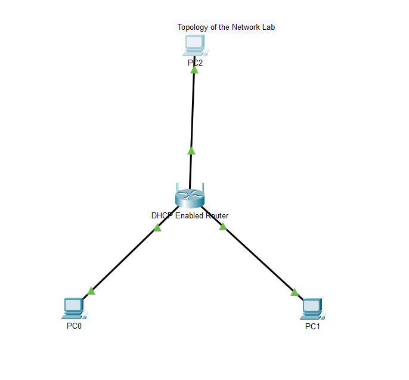
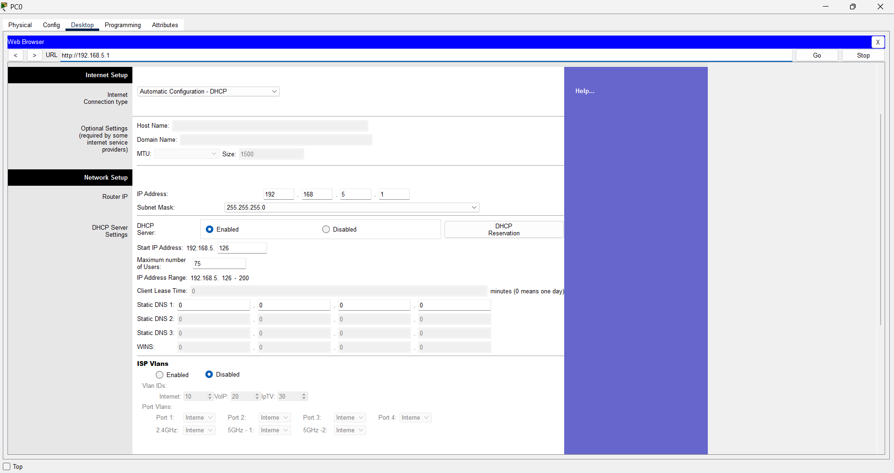
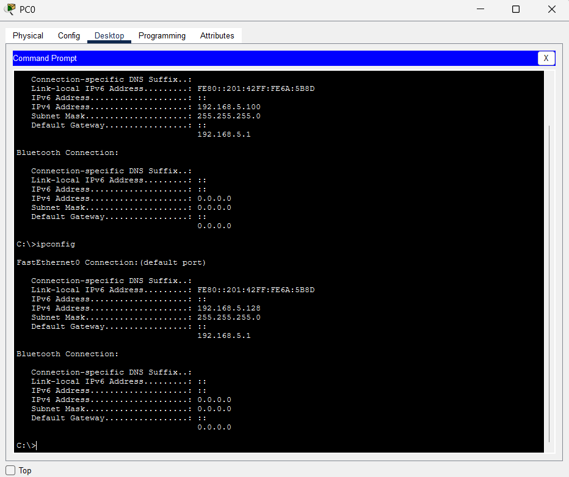
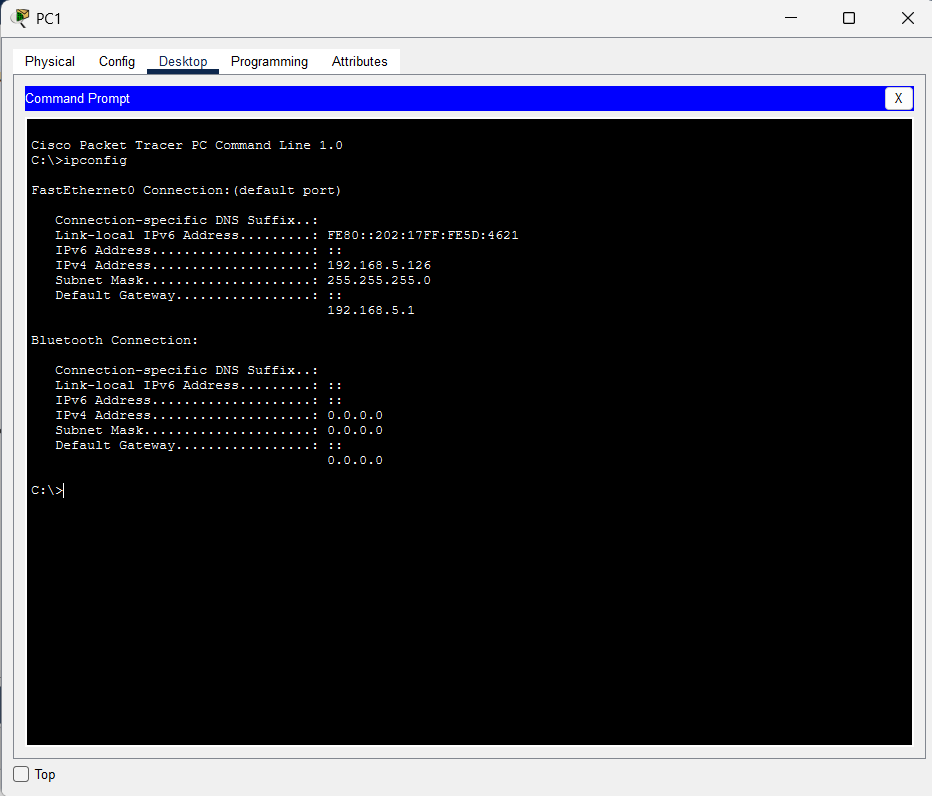
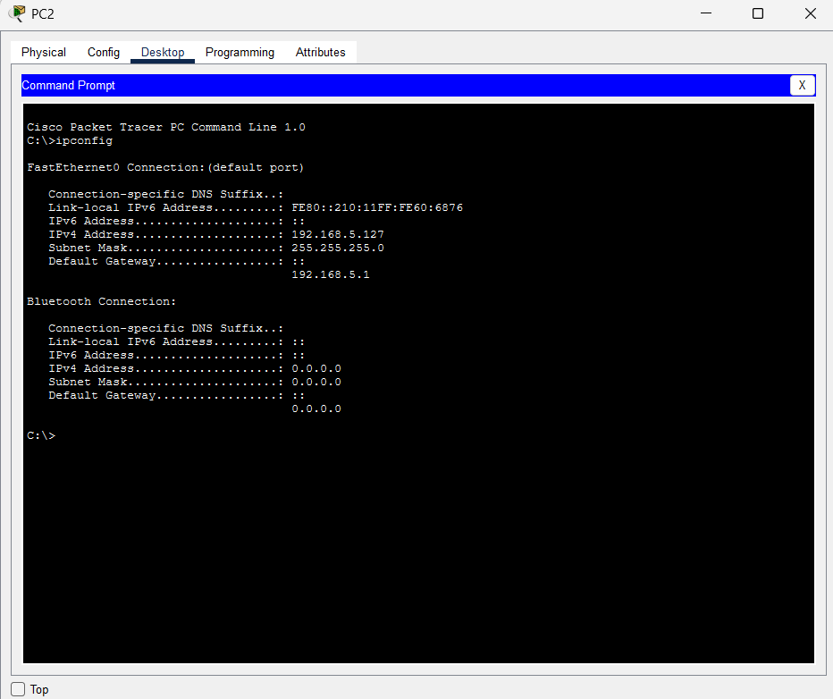
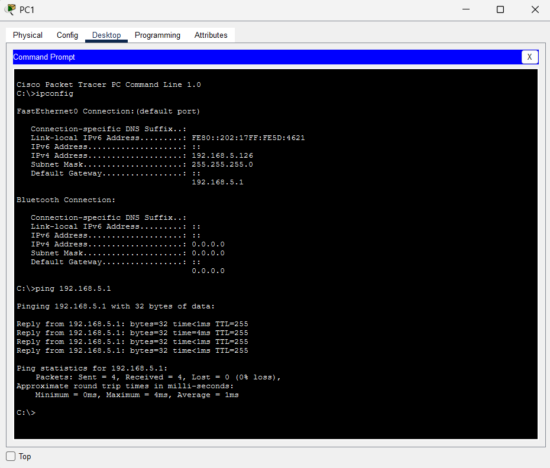
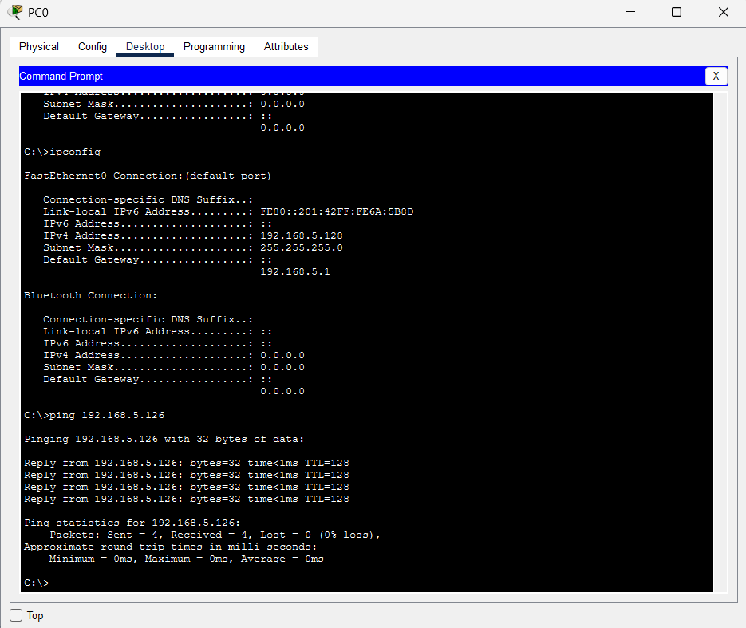
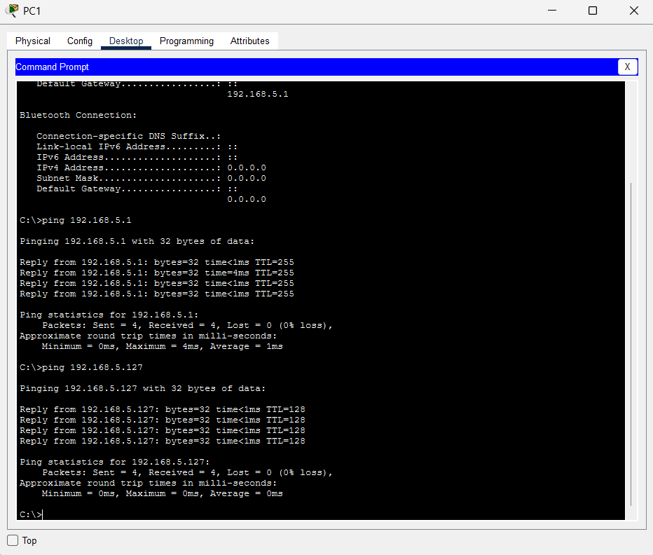

# Lab 01: Configure DHCP on a Wireless Router

## Objectives
- Connect 3 PCs to a wireless router
- Change the DHCP settings to a specific network range
- Configure the clients to obtain their addresses via DHCP

## Tools
- Cisco Packet Tracer

## Scenario
A home user wants to use a wireless router to connect 3 PCs. All 3 PCs must obtain their IP addresses automatically from the wireless router.

## Topology
Three generic PCs (PC0, PC1, PC2) are connected to the DHCP-enabled wireless router with straight-through Ethernet cables. All links are up (green).

## Configuration Summary
| Setting | Value |
|---------|-------|
| Default router IP (factory) | 192.168.0.1 |
| Router IP (changed to) | 192.168.5.1 |
| Subnet mask | 255.255.255.0 |
| DHCP server | Enabled |
| DHCP start address (changed to) | 192.168.5.126 |
| Maximum number of users | 75 |
| Resulting DHCP range | 192.168.5.126 - 192.168.5.200 |

### Router settings after configuration

## Client Addressing (obtained via DHCP)
| Device | IP Address | Subnet Mask | Default Gateway |
|--------|------------|-------------|-----------------|
| Router | 192.168.5.1 | 255.255.255.0 | - |
| PC0 | 192.168.5.128 | 255.255.255.0 | 192.168.5.1 |
| PC1 | 192.168.5.126 | 255.255.255.0 | 192.168.5.1 |
| PC2 | 192.168.5.127 | 255.255.255.0 | 192.168.5.1 |

### PC0
PC0 first held `192.168.5.100` from the old pool. After renewing its lease it received `192.168.5.128` from the new range.

### PC1

### PC2

## Steps Performed

### Part 1: Set up the network topology
1. Added three generic PCs to the workspace.
2. Connected each PC to an Ethernet port on the wireless router using straight-through cables.

### Part 2: Observe the default DHCP settings
1. Set PC0 to DHCP and recorded the default gateway address.
2. Opened the web browser on PC0 and entered the gateway address to reach the router's web interface (login: admin).
3. Reviewed the Basic Setup page: default router IP, DHCP enabled, start address and address range.

### Part 3: Change the default IP address of the router
1. Changed the router IP address to `192.168.5.1`.
2. Saved the settings. The web page showed an error, which is expected because the router's address changed.
3. Renewed the PC0 lease (Static, then DHCP again) to receive the new network information.
4. Logged back in to the router at `192.168.5.1`.

### Part 4: Change the default DHCP range
1. Confirmed that the DHCP pool had moved to the new `192.168.5.x` network.
2. Changed the starting IP address from `192.168.5.100` to `192.168.5.126`.
3. Changed the Maximum Number of Users to `75`.
4. Saved the settings and renewed the PC0 lease.
5. Verified the new address with `ipconfig`.

### Part 5: Enable DHCP on the other PCs
1. Set PC1 to DHCP and recorded its address (`192.168.5.126`).
2. Repeated the same steps on PC2 (`192.168.5.127`).

### Part 6: Verify connectivity
Connectivity was tested with `ping` between the devices and to the router.

**PC1 to the router (192.168.5.1): 4/4 replies, 0% loss**

**PC0 to PC1 (192.168.5.126): 4/4 replies, 0% loss**

**PC1 to the router and to PC2 (192.168.5.127): 4/4 replies, 0% loss**

## Verification Checklist
- [x] All three PCs received an IP address automatically via DHCP
- [x] Addresses fall inside the new DHCP range (192.168.5.126 - 192.168.5.200)
- [x] Default gateway on every PC is 192.168.5.1
- [x] Pings to the router, PC1 and PC2 were all successful (0% packet loss)

## Lessons Learned
- After changing the router's IP address, the web page shows an error and clients must renew their DHCP lease to join the new subnet.
- The DHCP pool follows the router's new subnet automatically.
- A PC keeps its old address until its lease is renewed, so each client must be refreshed after the DHCP range is changed.
- `ipconfig` and `ping` are quick ways to confirm both addressing and end-to-end connectivity.

## Files in This Folder
| File | Description |
|------|-------------|
| `11_2_3_Packet_Tracer_Configure_DHCP_on_a_Wireless_Router.pka` | Packet Tracer lab file (open with Cisco Packet Tracer) |
| `screenshots/` | Topology, router settings, client addressing and ping results |
