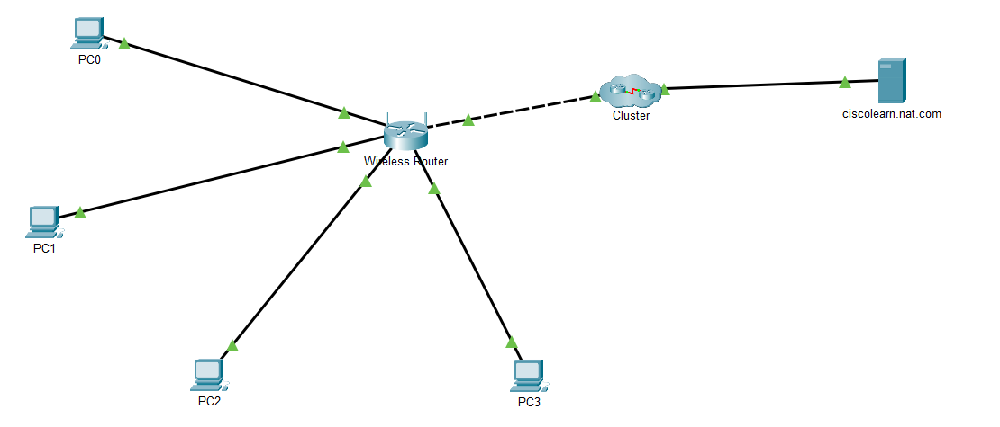
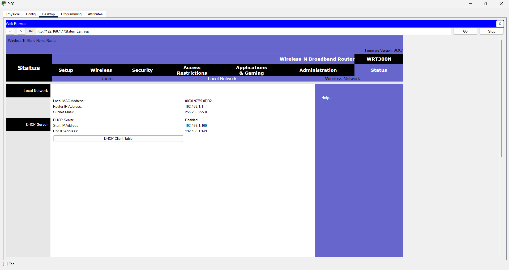
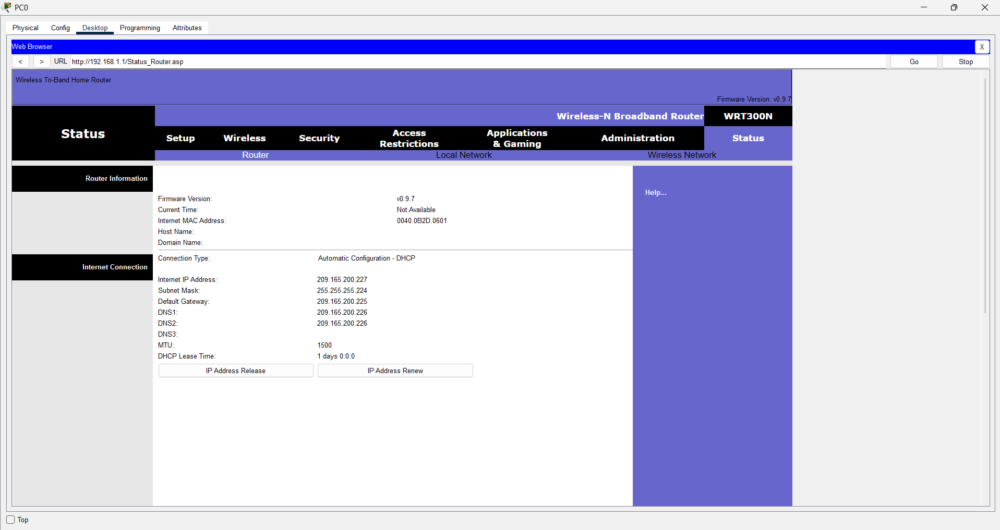
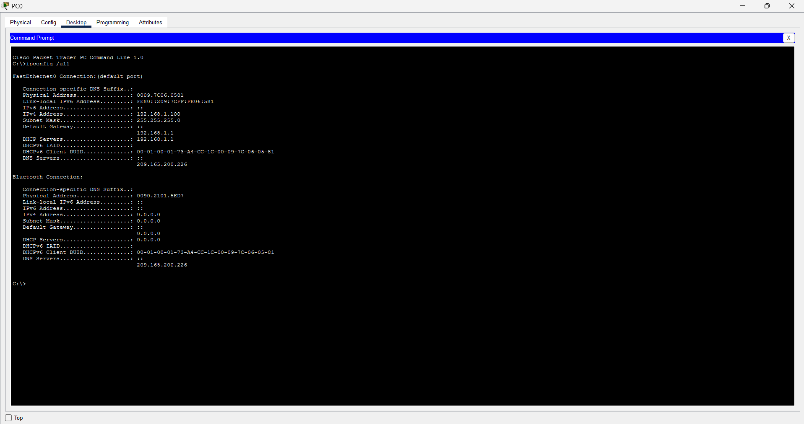
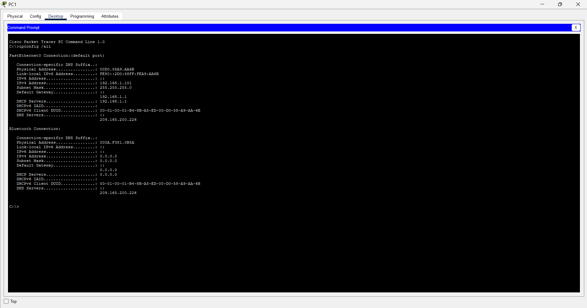
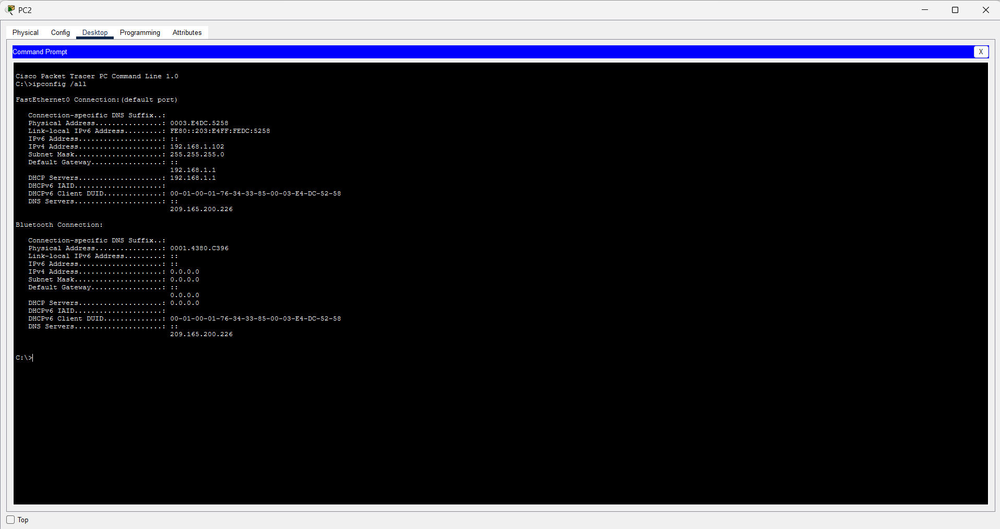
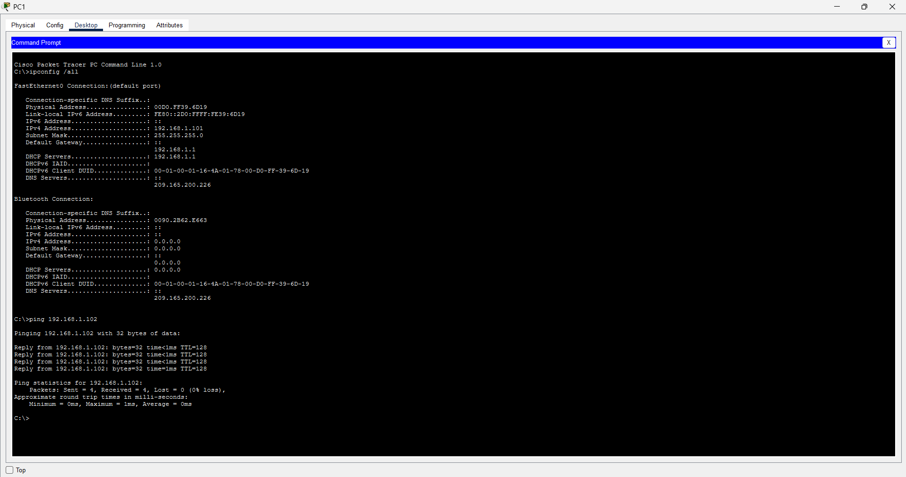
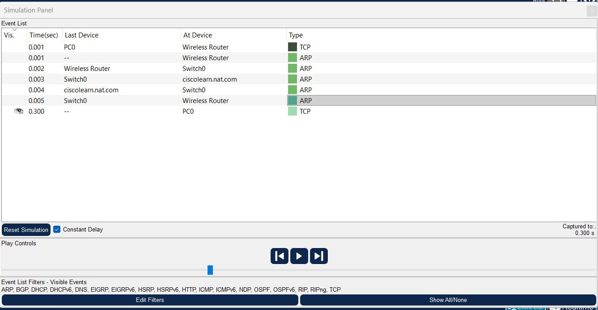
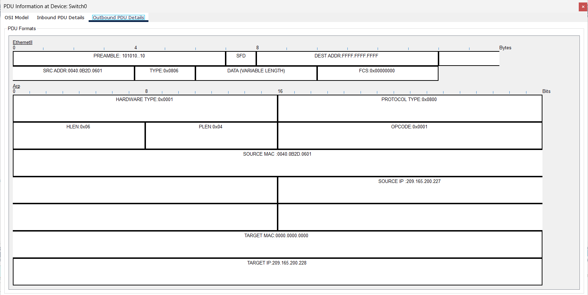
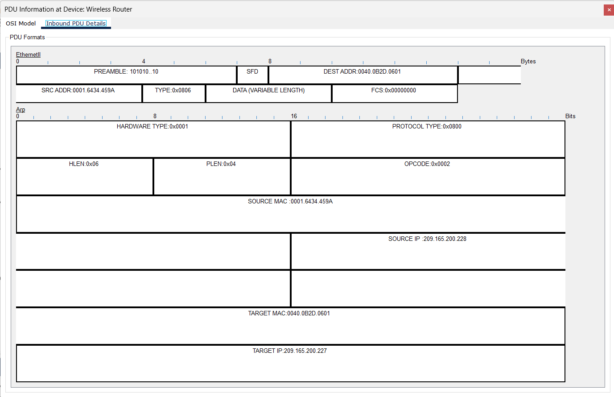

# Lab 02: Examine NAT on a Wireless Router

## Objectives
- Examine the LAN (inside) and internet (outside) settings of a wireless router
- Confirm that LAN clients receive private addresses from the router's DHCP server
- Verify connectivity between the PCs
- Observe traffic between a PC and an external web server in Simulation mode

## Tools
- Cisco Packet Tracer

## Scenario
Four PCs connect to a wireless router that sits between a private home network and an external network. The PCs use private IP addresses, while the router uses a single public address on its internet side. Network Address Translation (NAT) on the router allows the private hosts to reach the outside server.

## Topology
Four PCs (PC0 to PC3) connect to the wireless router. The router's internet port connects through a cluster to an external web server, `ciscolearn.nat.com`.

## Addressing Overview

| Side | Network | Address |
|------|---------|---------|
| Inside (LAN, private) | 192.168.1.0/24 | Router LAN IP: `192.168.1.1` |
| Outside (WAN, public) | 209.165.200.224/27 | Router internet IP: `209.165.200.227` |

### Router LAN (inside) settings
| Setting | Value |
|---------|-------|
| Router IP address | 192.168.1.1 |
| Subnet mask | 255.255.255.0 |
| DHCP server | Enabled |
| DHCP range | 192.168.1.100 - 192.168.1.149 |

### Router internet (outside) settings
| Setting | Value |
|---------|-------|
| Connection type | Automatic Configuration - DHCP |
| Internet IP address | **209.165.200.227** |
| Subnet mask | 255.255.255.224 |
| Default gateway | 209.165.200.225 |
| DNS | 209.165.200.226 |

## Client Addressing (obtained via DHCP)
| Device | IP Address | Subnet Mask | Default Gateway | DNS Server |
|--------|------------|-------------|-----------------|------------|
| PC0 | 192.168.1.100 | 255.255.255.0 | 192.168.1.1 | 209.165.200.226 |
| PC1 | 192.168.1.101 | 255.255.255.0 | 192.168.1.1 | 209.165.200.226 |
| PC2 | 192.168.1.102 | 255.255.255.0 | 192.168.1.1 | 209.165.200.226 |
| PC3 | 192.168.1.103 | 255.255.255.0 | 192.168.1.1 | 209.165.200.226 |

All four PCs get private addresses from the router's DHCP pool, with the router as their default gateway.

**PC0**

**PC1**

**PC2**

**PC3**

## Connectivity Tests (LAN)
Each PC pinged the next one in the ring. All tests returned 4/4 replies with 0% packet loss.

| From | To | Result |
|------|----|--------|
| PC0 | PC1 (192.168.1.101) | 4/4 replies, 0% loss |
| PC1 | PC2 (192.168.1.102) | 4/4 replies, 0% loss |
| PC2 | PC3 (192.168.1.103) | 4/4 replies, 0% loss |
| PC3 | PC0 (192.168.1.100) | 4/4 replies, 0% loss |

## Simulation Mode
In Simulation mode, a request from PC0 to `ciscolearn.nat.com` was captured as it crossed the router, the switch in the cluster, and the server.

Two of the captured packets, both ARP, show how the router behaves on its **outside** interface:

**ARP request leaving toward the server.** The source IP is the router's public address `209.165.200.227` and the target is the server at `209.165.200.228`. The packet uses the router's public address, not a private `192.168.1.x` address.

**ARP reply returning to the router.** The server (`209.165.200.228`) replies to the router's public address `209.165.200.227`.

## Key Takeaways
- The inside network uses private addresses (`192.168.1.0/24`) that cannot be routed on the internet.
- The router has one public address (`209.165.200.227`) on its internet side, and the outside network only ever sees that address.
- NAT on the router translates between the two, so every PC on the LAN can share the single public address.
- The router also acts as the DHCP server and default gateway for the LAN.

## Verification Checklist
- [x] Router LAN IP and DHCP range recorded (192.168.1.1, 192.168.1.100 - .149)
- [x] Router public (internet) IP recorded (209.165.200.227)
- [x] All four PCs received private addresses via DHCP
- [x] All LAN pings successful (0% loss)
- [x] Simulation mode used to capture traffic to the external server

## Files in This Folder
| File | Description |
|------|-------------|
| `12_2_2_Packet_Tracer_Examine_NAT_on_a_Wireless_Router.pka` | Packet Tracer lab file (open with Cisco Packet Tracer) |
| `screenshots/` | Topology, router settings, client addressing, pings and simulation captures |
